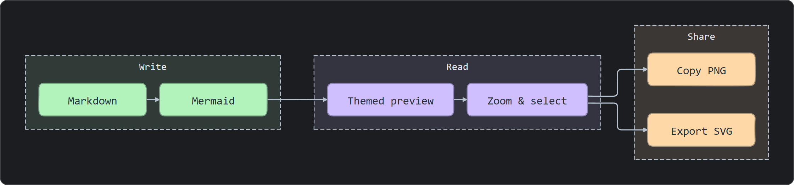
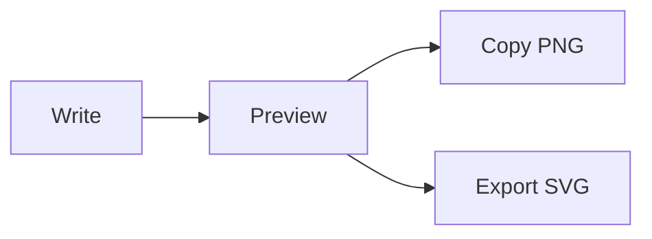

# Mermaid Flair

[](https://github.com/Nicander93/mermaid-flair/actions/workflows/ci.yml)

[简体中文](README.md) · English

Make Mermaid diagrams easier to read in Markdown. Mermaid Flair adds coordinated colors, curated themes, subtle hand-drawn outlines, zoom, selection and image copying to regular VS Code / Cursor previews and Obsidian Reading View.



[Light preview](docs/images/whiteboard-light.png) · [Diagram source](fixtures/mermaid/quick-start.md)

> **Public preview 0.5.2**: [Download plugin assets](https://github.com/Nicander93/mermaid-flair/releases/tag/0.5.2). Distribution is through GitHub Releases; the plugins are not yet listed in extension stores.

## Features

- Render diagrams inside your usual Markdown preview, alongside the surrounding text.
- Choose Whiteboard, Clean or Paper, following the host color mode and code font.
- Automatically color explicit flowchart groups and clear tree branches; preserve author-specified colors.
- Zoom, pan and highlight individual elements without selection rectangles.
- Copy complete diagrams as PNG, or save PNG and export SVG from the context menu.
- Render locally with bundled Mermaid, without an account or external rendering service.

## Install

Plugin assets are available from the [Releases page](https://github.com/Nicander93/mermaid-flair/releases). Source archives do not contain compiled plugins. If no Release exists, use the source build instructions below.

### VS Code / Cursor

1. Obtain `mermaid-flair-x.y.z.vsix`.
2. Open the Extensions panel menu and choose **Install from VSIX…**.
3. Run **Developer: Reload Window**.
4. Open your regular Markdown Preview, including Cursor's same-tab Preview.

Mermaid blocks are styled within the document. **Mermaid Flair: Open Diagram Preview** provides an optional separate pane.

### Obsidian desktop

1. Obtain the compiled plugin files: `main.js`, `manifest.json` and `styles.css`. Extract a plugin ZIP first if one is provided.
2. Place them directly inside `YourVault/.obsidian/plugins/mermaid-flair/`.
3. Enable Mermaid Flair under **Settings → Community plugins**. Reload the plugin or restart Obsidian after updating it.
4. Open the note in **Reading View**. Live Preview continues to use Obsidian's built-in renderer.

## Try a diagram

Paste this block into a Markdown document and open its preview:

````markdown

````

Hover over or focus the diagram to reveal the expand and copy-image buttons. The popup supports wheel zoom and drag panning; Escape closes it.

The copy button always copies the complete diagram with its current theme, excluding controls and selection highlights. Viewport zoom does not affect the result. PNG output uses up to 2× resolution with a 4096-pixel longest-edge limit.

## Themes and settings

| Theme | Appearance | Preview |
| --- | --- | --- |
| **Whiteboard**, the default | Soft categorical colors and subtle hand-drawn outlines | [Light](docs/images/whiteboard-light.png) · [Dark](docs/images/whiteboard-dark.png) |
| **Clean** | Restrained blue, teal and lavender with clean outlines | [View](docs/images/clean-light.png) |
| **Paper** | Warm paper with muted natural colors | [View](docs/images/paper-light.png) |

Dark mode keeps pastel nodes with dark node text. Titles and relationship labels remain light on the dark canvas. Default flowchart connections and sequence messages use brighter neutral lines and arrows at 2px.

In VS Code / Cursor, run **Mermaid Flair: Choose Default Theme** or search Settings for `Mermaid Flair`. In Obsidian, use the plugin settings page. Retired theme settings migrate to retained presets.

Both integrations can follow the host color mode and show controls on hover or focus. Disabling color-mode following keeps diagrams in light mode.

## Selection and shortcuts

| Action | Result |
| --- | --- |
| Click a node, connection or participant | Highlight that element |
| Ctrl / Cmd / Shift-click | Add or remove a selection |
| Enter on a focused diagram | Open the viewer |
| Escape in the viewer | Close it |
| Ctrl / Cmd+C on a focused diagram | Copy selected labels, or the whole image when nothing is selected |
| Right-click a diagram | Save PNG, export SVG and other actions |

Selection supports reading and highlighting. Diagram editing is not currently provided. Use the copy-image button when you want an image.

## Compatibility and limits

- The VS Code manifest requires version 1.96.0 or newer. Regular preview integration has automated coverage; current native VS Code / Cursor acceptance still has [documented gaps](docs/compatibility.md).
- Obsidian declares a minimum of 1.9.14. Version 0.5.2 passed Reading View, image-copy, settings-persistence and color-mode checks in the actual 1.15.0 runtime.
- Desktop use is the current target. Native acceptance on macOS, Linux and Obsidian mobile is incomplete.
- Flowcharts have structural automatic coloring. Regression samples also cover sequence, state, class, ER, Gantt, mindmap and pie diagrams. Hand-drawn decoration covers recognized flowchart and sequence geometry; other shapes retain Mermaid output.
- Remote images and external resources are blocked. Diagrams requiring those resources may fail to render. Invalid syntax produces an expandable diagnostic.

See [compatibility](docs/compatibility.md) and [support](SUPPORT.md) for details.

## Build from source

Use **Node.js 24** and **pnpm 11.8.0** from the repository root:

```sh
pnpm install --frozen-lockfile
pnpm check
pnpm exec playwright install chromium
pnpm test
pnpm package
```

Build outputs:

- `dist/mermaid-flair-x.y.z.vsix`: VS Code / Cursor installer.
- `dist/obsidian/mermaid-flair/`: Obsidian plugin directory, ready to copy into a vault.
- `dist/mermaid-flair-obsidian-x.y.z.zip` and `dist/SHA256SUMS.txt`: Obsidian ZIP and SHA-256 checksums for all release assets.

See [contributing](CONTRIBUTING.md) for the source layout and documentation image generation.

## Documentation

[Support](SUPPORT.md) · [Changelog](CHANGELOG.md) · [Privacy](docs/privacy.md) · [Validation](docs/test-plan.md) · [Publication preparation](docs/publishing.md)

## License

Source code is licensed under [MIT](LICENSE). Plugin bundles include `THIRD_PARTY_NOTICES.txt` with notices for dependencies actually included in each bundle.
