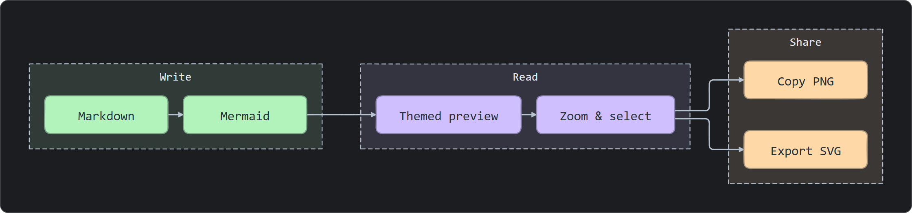
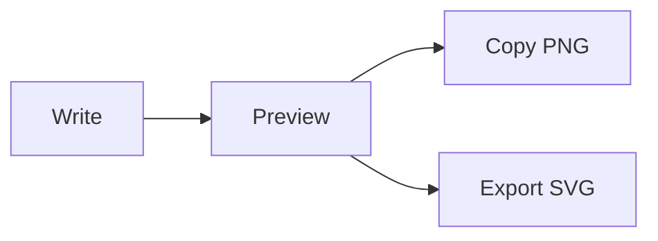

# Mermaid Flair

简体中文 · [English](README.en.md)

让 Markdown 中的 Mermaid 图表更易读。在 VS Code、Cursor 的普通预览和 Obsidian 阅读视图里，自动应用主题、协调配色与轻微手绘轮廓，并支持放大、选择和复制图像。



[查看亮色效果](docs/images/whiteboard-light.png) · [查看示例源码](fixtures/mermaid/quick-start.md)

> 当前版本为开发预览版 **0.5.2**，尚未上架插件商店。公开分发以仓库源码和插件安装包为主。若仓库尚无 Release，请先按下方说明从源码构建。

## 能做什么

- **直接使用普通预览**：Markdown 正文和图表留在同一篇文档中。
- **三套主题**：Whiteboard、Clean、Paper，跟随宿主明暗和代码字体。
- **自动配色**：流程图按明确的分组或树分支着色，原文指定的颜色优先。
- **专注阅读**：放大弹层支持缩放、平移和要素高亮，选择时只改变要素自身。
- **复制与导出**：一键复制完整 PNG，右键可保存 PNG 或导出 SVG。
- **本地渲染**：使用插件内置的 Mermaid，无需账号或外部渲染服务。

## 安装

发布后的安装包从[Releases](https://github.com/Nicander93/mermaid-flair/releases)获取。源码压缩包不包含编译好的插件；没有 Release 时可[从源码构建](#从源码构建)。

### VS Code / Cursor

1. 获取 `mermaid-flair-x.y.z.vsix`。
2. 在扩展面板的更多菜单中选择 **Install from VSIX…**，选中该文件。
3. 执行 **Developer: Reload Window**。
4. 打开 Markdown 文件，使用平常的 **Markdown Preview** 或 Cursor 的 **Preview**。

插件会处理文档中的 Mermaid 代码块。**Mermaid Flair: Open Diagram Preview** 是另一个可选入口。

### Obsidian 桌面版

1. 获取编译后的 Obsidian 插件文件。必需文件为 `main.js`、`manifest.json`、`styles.css`；如果下载的是插件 ZIP，先解压。
2. 将插件目录放到笔记库的 `.obsidian/plugins/mermaid-flair/` 下。目录结构应为：

   ```text
   YourVault/.obsidian/plugins/mermaid-flair/
   ├── main.js
   ├── manifest.json
   └── styles.css
   ```

3. 在 **设置 → 第三方插件** 中启用 Mermaid Flair；更新已有插件后重新加载插件或重启 Obsidian。
4. 切换到笔记的 **阅读视图**。Live Preview 仍使用 Obsidian 内置渲染。

## 试一张图

将下面的代码块放进 Markdown 文档，然后打开预览：

````markdown

````

悬停或聚焦图表，右上角会出现放大和复制图像两个按钮。点击放大后，滚轮缩放、拖动平移，Esc 关闭弹层。

复制按钮始终复制完整图表，保留当前主题，不包含按钮、选择高亮或菜单，也不受查看时的缩放影响。PNG 默认约 2× 分辨率，最长边上限为 4096 像素。

## 主题与设置

| 主题 | 外观 | 预览 |
| --- | --- | --- |
| **Whiteboard**（默认） | 柔和分类色，轻微手绘轮廓 | [亮色](docs/images/whiteboard-light.png) · [暗色](docs/images/whiteboard-dark.png) |
| **Clean** | 克制的蓝、青、紫配色，干净线条 | [查看](docs/images/clean-light.png) |
| **Paper** | 温暖纸色，低饱和自然色 | [查看](docs/images/paper-light.png) |

暗色模式保留浅彩节点和深色节点文字，画布上的标题、关系标签仍用浅色。流程图与时序消息的默认连线和箭头会一起提亮，线宽为 2px。

VS Code / Cursor 可以使用 **Mermaid Flair: Choose Default Theme** 命令，或在设置中搜索 `Mermaid Flair`。Obsidian 在插件设置页选择默认主题。旧版主题设置会自动映射到保留的预设。

两端均可设置是否跟随宿主明暗，以及是否显示悬浮工具按钮。关闭明暗跟随后，图表固定使用亮色模式。

## 选择与快捷操作

| 操作 | 结果 |
| --- | --- |
| 点击节点、连线或时序参与者 | 高亮该要素 |
| Ctrl / Cmd / Shift + 点击 | 添加或取消多选 |
| 聚焦图表后按 Enter | 打开放大弹层 |
| 在放大弹层按 Esc | 关闭弹层 |
| 聚焦图表后按 Ctrl / Cmd + C | 有选择时复制标签文字，否则复制整图 |
| 右键图表 | 保存 PNG、导出 SVG 等操作 |

选择用于阅读和高亮，插件目前不提供图表编辑。复制图像请使用右上角的复制按钮。

## 支持范围

- VS Code 清单要求 1.96.0 或更新版本。VS Code / Cursor 已有普通预览集成和自动回归；本版真实宿主交互仍有[待复验项](docs/compatibility.md)。
- Obsidian 最低声明版本为 1.9.14，0.5.2 已在实际运行时 1.15.0 中完成阅读视图、图像复制、主题保存与明暗切换验证。
- 目前面向桌面端。macOS、Linux 和 Obsidian 移动端尚未完成原生验收。
- 流程图支持自动分组配色；时序图、状态图、类图、ER、甘特、思维导图和饼图有回归样例。手绘装饰覆盖可识别的流程图和时序图几何元素，其余图形保留 Mermaid 输出。
- 不加载远程图片或外部资源。依赖这些资源的图表可能无法渲染；非法语法会显示可展开的诊断信息。

完整边界见[兼容性](docs/compatibility.md)，遇到问题请看[排查与反馈](SUPPORT.md)。

## 从源码构建

需要 **Node.js 24** 和 **pnpm 11.8.0**。在仓库根目录运行：

```sh
pnpm install --frozen-lockfile
pnpm check
pnpm exec playwright install chromium
pnpm test
pnpm package
```

产物包括：

- `dist/mermaid-flair-x.y.z.vsix`：VS Code / Cursor 安装包。
- `dist/obsidian/mermaid-flair/`：可直接复制到笔记库的 Obsidian 插件目录。
- `dist/mermaid-flair-obsidian-x.y.z.zip` 与 `dist/SHA256SUMS.txt`：Obsidian 压缩包与全部安装附件的 SHA-256 校验值。

开发说明、目录分工与截图生成方法见[贡献指南](CONTRIBUTING.md)。

## 文档与反馈

[排查与反馈](SUPPORT.md) · [更新记录](CHANGELOG.md) · [隐私说明](docs/privacy.md) · [测试记录](docs/test-plan.md) · [发布准备](docs/publishing.md)

## 许可

源码采用 [MIT License](LICENSE)。安装包包含 `THIRD_PARTY_NOTICES.txt`，列出实际打包依赖的许可与声明。
