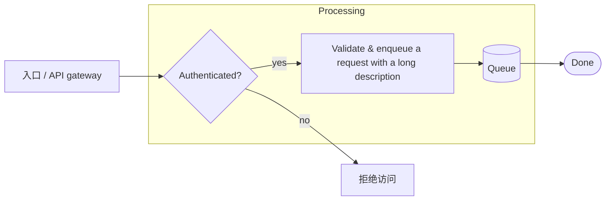
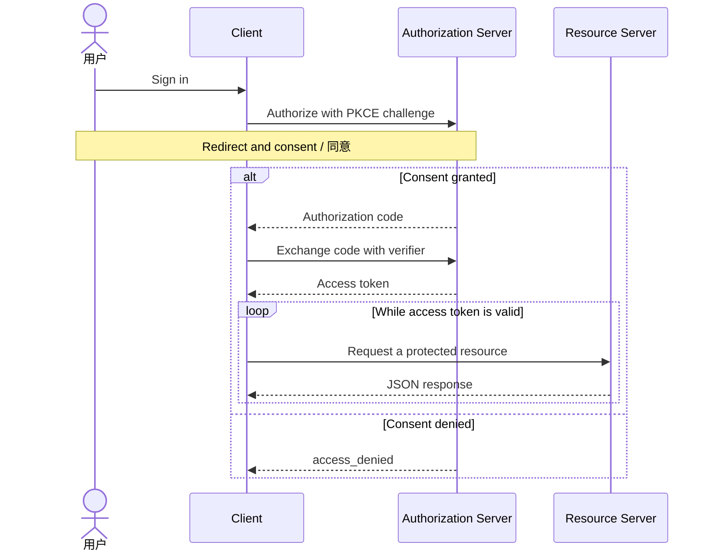
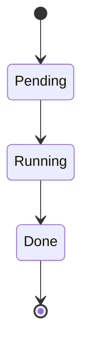
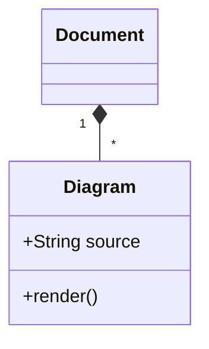
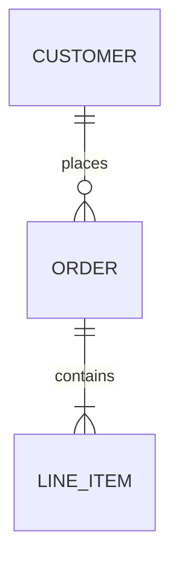
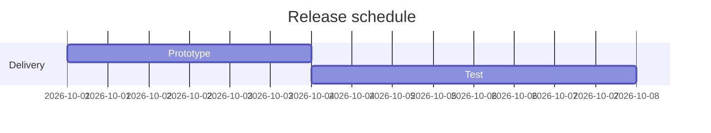
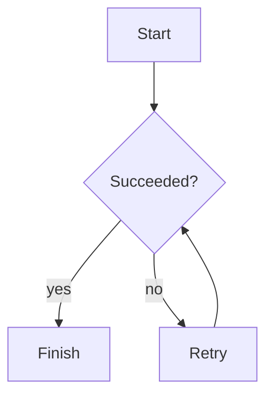
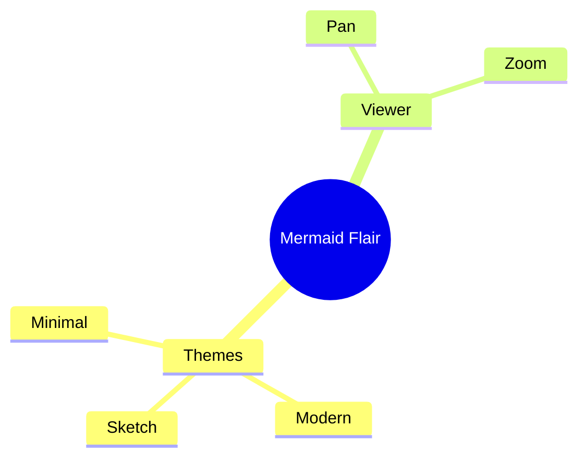
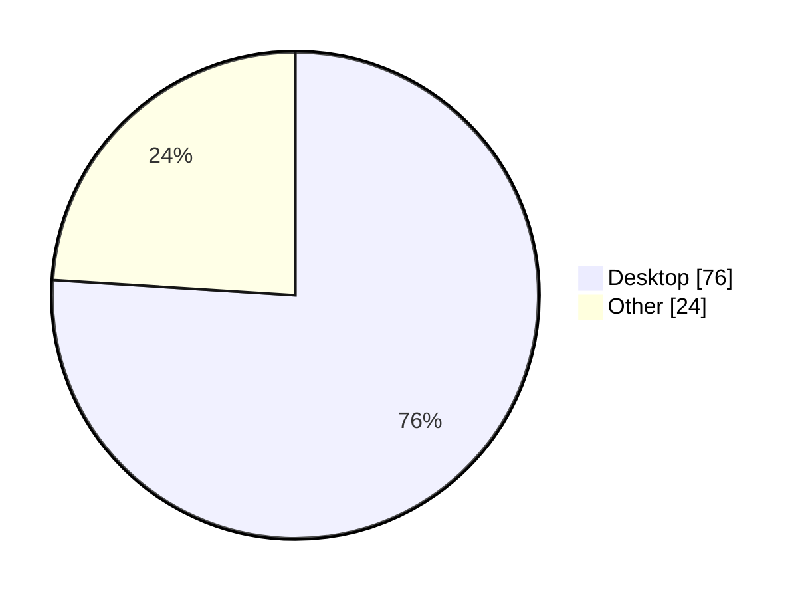

# Mermaid Flair regression note

## Request routing



## OAuth2



## Lifecycle



## Class



## Entities



## Milestones



## Invalid

```mermaid
flowchart LR
  A --> [
```

## Failure recovery



## Mind map



## Distribution



```text
This code fence is deliberately not a diagram.
```
